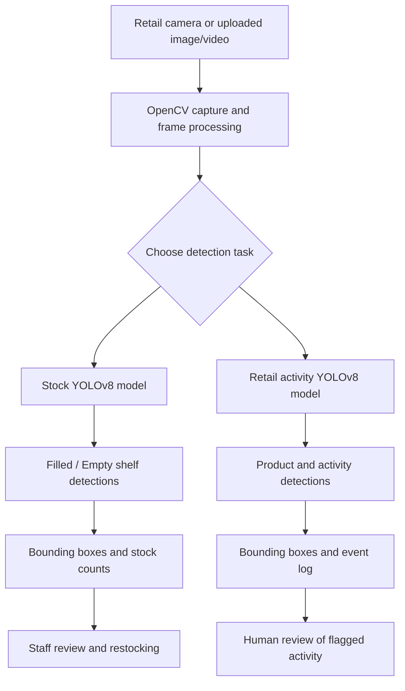

# Advanced Image Recognition for Retail Stock Management

[](https://github.com/haady7/Real-Time-Stock-Management-System-for-Retail-Store/actions/workflows/ci.yml)

A computer-vision solution for smarter retail inventory monitoring. This project uses **Python, YOLOv8, Roboflow, and OpenCV** to identify shelf availability from images and video, highlight selected retail activities, and create visual records that store teams can review.

## Project overview

Keeping shelves stocked is an important part of running a retail store. Manual shelf inspections take time, can be inconsistent, and may not identify an empty section until a customer has already looked for a product.

This project applies image recognition to make shelf monitoring more efficient. A camera or uploaded image provides the visual input. The system processes the image or video frame, runs it through a trained object-detection model, and displays the detected classes with bounding boxes and confidence scores.

The solution covers two related tasks:

**1. Shelf stock monitoring**

A YOLOv8 model identifies shelf sections as:

- `Filled` — a shelf area classified as stocked.
- `Empty` — a shelf area classified as empty and potentially requiring restocking.

This helps staff locate shelves that need attention and supports better inventory visibility.

**2. Retail activity monitoring**

A second model identifies configured visual classes associated with product and customer activity, including:

- `Product-Picked`
- `Customer-Bagpack`
- `Shoplifting`

These detections can be saved and reviewed by store staff. A `Shoplifting` prediction is only a model output; it is not proof of theft or wrongdoing and must always be checked by an authorized person.

## Problem statement

Traditional retail stock management can involve frequent manual shelf checks and separate security review. This creates several challenges:

- **Manual effort:** employees spend time walking through aisles and checking shelf availability.
- **Stockouts:** empty shelf sections may go unnoticed, affecting product availability and customer experience.
- **Overstocking:** inaccurate stock visibility can contribute to unnecessary replenishment.
- **Shelf organization:** checking whether products are in their expected locations can be difficult at scale.
- **Event review:** store teams may need to review product/customer activity across video footage.

The project uses computer vision to automate parts of visual monitoring and provide clearer information for operational decisions.

## Objectives

- Detect filled and empty shelf sections from images or video.
- Monitor retail shelves with object-detection models.
- Display detected objects with bounding boxes and confidence scores.
- Count detections and save visual output for inspection.
- Record selected activity detections with timestamps and frame numbers.
- Support future integration with restocking workflows, planogram checks, and store alerts.

## System architecture

The system uses two YOLOv8 models hosted through Roboflow. OpenCV handles image and video processing, while the inference workflow returns class labels, confidence values, and bounding-box coordinates.



### How the detection process works

1. **Image or video input:** the system receives a shelf image, recorded video, or webcam feed.
2. **Frame extraction:** OpenCV reads the image or extracts frames from the video.
3. **Preprocessing:** frames are resized and prepared for model inference.
4. **Object detection:** the appropriate YOLOv8 model analyzes the image through Roboflow.
5. **Prediction handling:** the system reads the detected class, confidence score, and bounding-box coordinates.
6. **Visualization:** OpenCV draws boxes and labels around detected regions.
7. **Output and logging:** annotated images or videos are saved, and video detections are written to a CSV file.
8. **Review:** staff inspect empty-shelf results and flagged activity before taking action.

## Dataset and model training

The project uses separate datasets for shelf monitoring and retail activity detection.

| Dataset | Description |
|---|---|
| Shelf images | 10,000+ images of retail shelves |
| Activity videos | 5,000+ annotated video clips |
| Shelf classes | Filled, Empty |
| Activity classes | Shoplifting, Product-Picked, Customer-Bagpack |

The model-development workflow includes:

- Image annotation using Roboflow.
- Resizing images to 640 × 640 pixels.
- Normalization and image augmentation, including rotation and brightness adjustments.
- Dataset split of 70% training, 20% validation, and 10% testing.
- Transfer learning using pretrained COCO weights.
- Training and hosting YOLOv8 models for the two detection tasks.

The original datasets and trained model weights are not included in this public repository. To run inference, configure your own Roboflow workspace, API key, and model IDs.

## Technology stack

| Technology | Role |
|---|---|
| **Python** | Main programming language |
| **YOLOv8** | Object detection for shelf and activity classes |
| **Roboflow** | Image annotation, dataset preparation, model training, hosting, and inference |
| **OpenCV** | Image/video capture, frame processing, bounding boxes, and output |
| **Google Colab** | Model development and experimentation |
| **CSV** | Storage of video detection events |
| **pytest** | Unit testing |
| **GitHub Actions** | Automated test workflow |

## Project results

The project evaluation recorded the following results:

| Metric | Result |
|---|---:|
| Stock classification precision | 92% |
| Theft-detection accuracy | 85% |
| Theft-detection F1-score | 0.83 |
| Planogram adherence | 95% |
| Processing speed on the tested edge setup | 30+ FPS |
| Detection-to-alert latency | Below 500 ms |
| Stockout reduction in the described pilot | 35% |
| Theft-incident reduction in the described pilot | 50% |

These figures reflect the project evaluation and its test setup. Performance can vary with camera placement, lighting, dataset quality, model version, and hardware. The original training data and full evaluation environment are not distributed in this repository, so these figures are not independently reproducible from the included code alone.

## Visual samples

The following images show shelf-recognition outputs and examples of the project's visual results.


More details and captions are available in the [sample gallery](README/README.md).

## Repository implementation

The public repository contains a configurable Python implementation of the image and video inference workflows.

| File | Description |
|---|---|
| `src/retail_vision/config.py` | Loads Roboflow configuration from environment variables |
| `src/retail_vision/vision.py` | Converts bounding boxes, annotates detections, and counts classes |
| `src/retail_vision/runner.py` | Runs image and video inference and saves outputs |
| `src/retail_vision/cli.py` | Provides command-line commands |
| `tests/test_vision.py` | Tests computer-vision helper functions |
| `.github/workflows/ci.yml` | Runs automated tests on GitHub |

The full system design also includes planogram verification, SMS/email notifications, inventory and ERP integration, automatic purchase-order workflows, posture analysis, a central dashboard, and edge deployment. These extended integrations are part of the broader project design but are not yet implemented as complete features in the current public code.

## Installation and setup

### Requirements

- Python 3.10 or newer.
- A Roboflow account with access to your trained model versions.
- A shelf image, video file, or webcam.

### 1. Clone the repository

```bash
git clone https://github.com/haady7/Real-Time-Stock-Management-System-for-Retail-Store.git
cd Real-Time-Stock-Management-System-for-Retail-Store
python -m venv .venv
```

### 2. Activate the virtual environment

**Windows PowerShell**

```powershell
.venv\Scripts\Activate.ps1
```

**macOS / Linux**

```bash
source .venv/bin/activate
```

### 3. Install dependencies

```bash
python -m pip install --upgrade pip
pip install -e .
```

For development and tests:

```bash
pip install -r requirements-dev.txt
```

### 4. Configure Roboflow

Copy `.env.example` to `.env` and enter your own credentials and model IDs.

**Windows PowerShell**

```powershell
Copy-Item .env.example .env
```

**macOS / Linux**

```bash
cp .env.example .env
```

Edit the new `.env` file:

```dotenv
ROBOFLOW_API_KEY=your_private_roboflow_api_key
ROBOFLOW_API_URL=https://serverless.roboflow.com
STOCK_MODEL_ID=your-workspace/your-stock-model/1
THEFT_MODEL_ID=your-workspace/your-activity-model/1
```

Replace the example values with your own Roboflow credentials and model IDs. Never commit the populated `.env` file.

### 5. Run shelf detection on an image

```bash
retail-vision stock-image --image path/to/shelf.jpg
```

To choose an output path:

```bash
retail-vision stock-image --image path/to/shelf.jpg --output outputs/shelf-result.jpg
```

### 6. Run activity detection on a video

```bash
retail-vision video --source path/to/store-video.mp4
```

To use a webcam:

```bash
retail-vision video --source 0 --preview
```

The video command saves an annotated MP4 and a CSV detection log under `outputs/`. Press `q` in the preview window to stop processing.

### 7. Run tests

```bash
pytest
```

The unit tests do not call Roboflow and do not require API credentials.

## Limitations and responsible use

- Detection quality depends on model training, dataset quality, lighting, camera angle, occlusion, and product packaging.
- The original datasets and trained model weights are not included.
- The current public code provides reference inference workflows, not a complete production retail platform.
- A `Shoplifting` prediction is not proof of theft. It must never be used as the sole basis for action against a person.
- CCTV footage should only be used with appropriate authorization and notice. Restrict access and apply suitable retention limits.
- Do not upload private store footage, personal data, or licensed datasets to this public repository.

## Security

A previous version of the project code contained hard-coded Roboflow API credentials. Those values have not been included in this public repository. Revoke and rotate any credentials that may have been exposed, and store new credentials only in your local `.env` file.

See [SECURITY.md](SECURITY.md) for security guidance.

## Project information

**Project:** Advanced Image Recognition for Retail Stock Management  
**Degree:** Bachelor of Engineering (B.E.)  
**Department:** Computer Science and Engineering — Artificial Intelligence & Machine Learning  
**Institute:** M. H. Saboo Siddik College of Engineering  
**University:** University of Mumbai  
**Academic year:** 2024–25

### Project contributors

- Haady Liyaqat Palekar
- Maaz Abubakkar Tole
- Mohd Adnan Mirza

See [CITATION.cff](CITATION.cff) for citation details and [CONTRIBUTING.md](CONTRIBUTING.md) for contribution guidelines.

## License

No open-source license has been selected for this co-authored project. Public visibility does not by itself grant permission to reuse the work. Obtain agreement from the project contributors before adding a license or redistributing contributed material.
