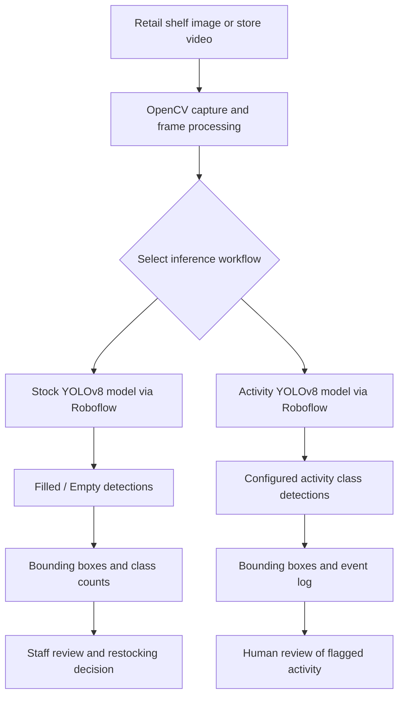

# Advanced Image Recognition for Retail Stock Management

[](https://github.com/haady7/Real-Time-Stock-Management-System-for-Retail-Store/actions/workflows/ci.yml)

A computer-vision project that explores how retailers can use image recognition to monitor shelf availability and flag selected store activities for staff review. The system described in the academic project uses **YOLOv8, Roboflow, Python, and OpenCV** to analyze shelf images and video feeds.


## 1. Project overview

Retail stores need accurate, up-to-date information about what is available on their shelves. In traditional workflows, employees may have to walk through aisles, inspect shelves manually, and update stock records. This can take time and can lead to inaccurate inventory information.

This project explores an image-recognition approach to assist with that work. Cameras capture images or video of retail shelves. A computer-vision model analyzes the frames and identifies shelf sections or configured activity classes. The output can be visualized with bounding boxes and recorded so that staff can review possible stock issues or events.

The academic report describes two related use cases:

1. **Retail stock monitoring:** identify shelf sections classified as `Filled` or `Empty`, helping staff locate areas that may need restocking.
2. **Retail activity / theft review:** detect configured visual classes such as `Product-Picked`, `Customer-Bagpack`, and `Shoplifting`, flagging model predictions for human review.

The goal is to support inventory visibility and store operations. Automated detections are decision-support signals, not proof that an event occurred or that a person has done something wrong.

## 2. Problem statement

Manual inventory monitoring creates several operational challenges:

- **Time-consuming shelf checks:** employees have to inspect shelves regularly to identify missing or low-stock products.
- **Stockouts:** an item may be unavailable to customers if an empty shelf is not noticed in time.
- **Overstocking:** inaccurate inventory information can contribute to ordering more stock than required.
- **Planogram compliance:** it can be difficult to check whether products are placed in their expected shelf locations.
- **Loss prevention:** store teams may want to review selected product/customer activity, but manual monitoring does not automatically organize those events for later inspection.

This project investigates whether computer vision can reduce the amount of manual checking and provide more timely visual information to store staff.

## 3. Project objectives

- Detect and classify shelf regions as `Filled` or `Empty`.
- Monitor shelf images or video frames using computer-vision models.
- Visualize model predictions with bounding boxes and class labels.
- Record detected classes and event details for review.
- Explore planogram checking and stock-restocking alerts.
- Explore a second model for identifying configured retail activity classes.
- Provide a workflow that can be extended with inventory systems and staff notifications.

## 4. How the system works

The academic report describes two YOLOv8 models trained for different tasks and accessed through Roboflow.

### A. Stock-management model

The stock model analyzes an image of a retail shelf and returns detections for the shelf classes on which it was trained, such as:

- `Filled` — the shelf region is classified as filled.
- `Empty` — the shelf region is classified as empty.

The application can draw bounding boxes around the returned detections and count the classes. An empty-shelf result can help staff decide which shelves need inspection or restocking.

### B. Retail activity model

The second model is intended to recognize the activity/object classes configured in its Roboflow dataset. The report mentions labels including:

- `Product-Picked`
- `Customer-Bagpack`
- `Shoplifting`

The system can annotate the frame and record predictions with a timestamp and frame number. A prediction labelled `Shoplifting` is only a model output. It must be checked by authorized staff and must never be treated as proof of theft.

### C. Processing workflow

1. **Video/image capture:** obtain a shelf image, a video file, or a live webcam stream.
2. **Frame processing:** use OpenCV to read images or extract frames from video.
3. **Model inference:** send the image or frame to the relevant Roboflow-hosted model.
4. **Detection results:** receive predicted classes, confidence scores, and bounding-box coordinates.
5. **Visualization:** draw bounding boxes and labels on the image or frame.
6. **Output and logging:** save an annotated image/video and record video detections in a CSV file.
7. **Human review:** staff inspect empty-shelf alerts or flagged activity before taking action.

### Architecture overview



The diagram summarizes the two inference paths. The extended academic architecture also discusses alerts, planogram checks, inventory/ERP integration, edge deployment, posture estimation, and model feedback. Those extended components are not all implemented in the current repository code.

## 5. Dataset and model approach described in the report

The academic report describes the following data preparation approach:

| Area | Details stated in the report |
|---|---|
| Shelf data | 10,000+ images of retail shelves |
| Activity data | 5,000+ annotated video clips |
| Shelf classes | Filled and Empty |
| Activity classes | Shoplifting, Product-Picked, Customer-Bagpack |
| Dataset split | 70% training, 20% validation, 10% testing |
| Input size | 640 × 640 pixels |
| Augmentation | Rotation and brightness adjustments |
| Training approach | Transfer learning from pretrained COCO weights |

The report describes Roboflow as the platform for annotation, preprocessing, augmentation, model training, and model hosting. The original training dataset and trained model weights are not included in this public GitHub repository. To run inference, configure your own Roboflow workspace, API key, and model IDs.

See [Dataset Guide](docs/DATASET_GUIDE.md) and [Roboflow Setup](docs/ROBOFLOW_SETUP.md) for more details.

## 6. Technology stack

| Technology | How it is used in the project |
|---|---|
| **Python** | Main programming language for inference and workflow logic |
| **YOLOv8** | Object-detection model family used for shelf and activity detection |
| **Roboflow** | Dataset annotation, training workflow, model hosting, and inference |
| **OpenCV** | Reading images/video, extracting frames, drawing boxes, and saving output |
| **Google Colab** | Development/training environment mentioned in the academic report |
| **CSV** | Recording frame-level detection results |

## 7. Repository implementation

This public repository contains a cleaned, configurable reference implementation of the inference workflows.

| Component | Current functionality |
|---|---|
| `src/retail_vision/config.py` | Loads Roboflow settings from environment variables |
| `src/retail_vision/vision.py` | Converts bounding boxes, annotates detections, and counts classes |
| `src/retail_vision/runner.py` | Runs image and video inference and saves output |
| `src/retail_vision/cli.py` | Provides command-line commands |
| `tests/` | Tests computer-vision helper functions |
| `.github/workflows/ci.yml` | Runs the test suite through GitHub Actions |

### What is currently runnable

- **Stock image inference:** submit one shelf image to your configured stock model and save an annotated image.
- **Activity video inference:** process a video file or webcam frames using your configured activity model, save an annotated MP4, and write prediction details to a CSV file.

### What is not included as executable functionality

The academic report also discusses SMS/email alerts, ERP synchronization, automatic purchase orders, planogram verification, posture estimation/OpenPose, a central dashboard, and Jetson Nano edge deployment. These are proposed or described as parts of the broader system in the report, but are **not implemented as complete integrations in the current repository**.

## 8. Results stated in the academic report

The following values are reproduced from the submitted academic report:

| Metric | Value stated in the report |
|---|---:|
| Stock classification precision | 92% |
| Theft-detection accuracy | 85% |
| Theft-detection F1-score | 0.83 |
| Planogram adherence | 95% |
| Processing speed on the described edge setup | 30+ FPS |
| Detection-to-alert latency | Below 500 ms |
| Stockout reduction in the described pilot | 35% |
| Theft-incident reduction in the described pilot | 50% |

**Important:** These are figures stated in the academic report. The source datasets, full evaluation protocol, and independent reproduction are not included in this repository. They should be presented as report-reported results, not as benchmarks independently verified by the current code.

For the report-grounded summary, see [Project Overview](docs/PROJECT_OVERVIEW.md) and [Project Report Summary](docs/PROJECT_REPORT_SUMMARY.md).

## 9. Visual samples

The repository includes the original sample output and two shelf-recognition examples from the academic report.


See [README sample gallery](README/README.md) for captions and printed report page references. CCTV theft-detection example images showing people have been excluded from the public gallery.

## 10. Installation and setup

### Requirements

- Python 3.10 or newer.
- A Roboflow account with access to the relevant trained model versions.
- A shelf image, video file, or webcam.

### Clone the repository

```bash
git clone https://github.com/haady7/Real-Time-Stock-Management-System-for-Retail-Store.git
cd Real-Time-Stock-Management-System-for-Retail-Store
python -m venv .venv
```

Activate the environment.

**Windows PowerShell**

```powershell
.venv\Scripts\Activate.ps1
```

**macOS / Linux**

```bash
source .venv/bin/activate
```

Install the project:

```bash
python -m pip install --upgrade pip
pip install -e .
```

### Configure Roboflow

Copy `.env.example` to `.env` and enter your own values:

```dotenv
ROBOFLOW_API_KEY=your_private_roboflow_api_key
ROBOFLOW_API_URL=https://serverless.roboflow.com
STOCK_MODEL_ID=your-workspace/your-stock-model/1
THEFT_MODEL_ID=your-workspace/your-activity-model/1
```

The values above are examples. Replace them with the credentials and model IDs from your own Roboflow workspace. Never commit your populated `.env` file.

### Run stock detection on an image

```bash
retail-vision stock-image --image path/to/shelf.jpg
```

Specify a different output location:

```bash
retail-vision stock-image --image path/to/shelf.jpg --output outputs/shelf-result.jpg
```

### Run activity detection on a video

```bash
retail-vision video --source path/to/store-video.mp4
```

Use the default webcam:

```bash
retail-vision video --source 0 --preview
```

The video command saves an annotated MP4 and a CSV detection log under `outputs/`. Press `q` in the preview window to stop.

### Run tests

```bash
pip install -r requirements-dev.txt
pytest
```

The unit tests do not call Roboflow and do not require API credentials.

## 11. Limitations and responsible use

- Model performance depends on the quality, diversity, and labeling of the training data.
- Shelf appearance can change with lighting, camera angle, occlusion, packaging changes, and product arrangement.
- A configured class prediction can be incorrect. All operational alerts require human review.
- A model prediction labelled `Shoplifting` is not proof of theft and must not be used as the sole basis for action against a person.
- CCTV footage must be used only with appropriate authorization and notice. Access should be restricted and retention limited.
- The original datasets and trained models are not distributed in this repository.

## 12. Security

The supplied academic report appendix contained hard-coded Roboflow credentials. Those values have intentionally not been copied into this public repository. Revoke and rotate any exposed keys in Roboflow before reuse. Store new credentials only in a local `.env` file, which is excluded from Git by `.gitignore`.

See [SECURITY.md](SECURITY.md).

## 13. Academic context and contributors

Based on the B.E. project report *Advanced Image Recognition for Retail Stock Management* (2024–25), Computer Science and Engineering (Artificial Intelligence & Machine Learning), M. H. Saboo Siddik College of Engineering, University of Mumbai.

The report lists the following student contributors:

- Haady Liyaqat Palekar
- Maaz Abubakkar Tole
- Mohd Adnan Mirza

See [CITATION.cff](CITATION.cff) for citation metadata and [CONTRIBUTING.md](CONTRIBUTING.md) for repository contribution guidance.

## License

No open-source license has been selected for this co-authored academic project. Public visibility does not by itself grant permission to reuse the report, code, or other contributors' work. Obtain agreement from the project contributors before adding a license or redistributing contributed material.
