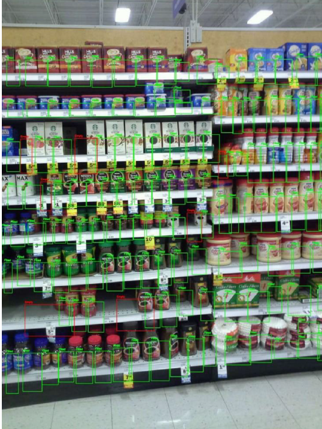
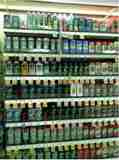
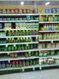

# Advanced Image Recognition for Retail Stock Management

[](https://github.com/haady7/Real-Time-Stock-Management-System-for-Retail-Store/actions/workflows/ci.yml)

A computer-vision project for retail shelf monitoring and visual activity review using **Python, YOLOv8, Roboflow, and OpenCV**.

The academic project describes two workflows:

- **Shelf stock monitoring:** classify shelf sections as `Filled` or `Empty` to help staff identify areas that may need restocking.
- **Retail activity review:** detect configured visual classes such as `Product-Picked` and `Shoplifting`, then record predictions for human review.

> **Project status:** This repository contains configurable reference inference scripts and project documentation. The original datasets and trained model weights are not included. You must supply your own Roboflow workspace, API key, and model IDs. Results mentioned in the academic report are not independently reproduced by this repository.



## Visual samples

The gallery includes the original repository output and two shelf-recognition examples from the academic report.






See [README/README.md](README/README.md) for captions and source-page references.

## Features

- Roboflow-hosted object detection on a shelf image.
- Video/webcam frame processing with OpenCV.
- Bounding-box annotations and confidence labels.
- CSV logging of video detections and timestamps.
- Environment-based credential configuration.
- Basic tests for computer-vision helper functions.
- GitHub Actions test workflow.

## Repository structure

```text
.
├── .github/
│   └── workflows/
│       └── ci.yml
├── README/
│   ├── README.md
│   └── samples/
│       ├── README.md
│       ├── shelf-detection-01.svg
│       └── shelf-detection-02.svg
├── data/
│   └── README.md
├── docs/
│   ├── DATASET_GUIDE.md
│   ├── PROJECT_OVERVIEW.md
│   ├── PROJECT_REPORT_SUMMARY.md
│   └── ROBOFLOW_SETUP.md
├── src/
│   └── retail_vision/
│       ├── __init__.py
│       ├── cli.py
│       ├── config.py
│       ├── runner.py
│       └── vision.py
├── tests/
│   └── test_vision.py
├── output.png                 # original sample retained for compatibility
├── .env.example
├── .gitignore
├── CITATION.cff
├── CONTRIBUTING.md
├── pyproject.toml
├── requirements.txt
├── requirements-dev.txt
└── SECURITY.md
```

## Technology stack

| Technology | Purpose |
|---|---|
| Python | Application and inference orchestration |
| YOLOv8 | Object-detection model family described in the report |
| Roboflow | Dataset annotation, model training/hosting, and inference |
| OpenCV | Image/video capture, annotation, and export |
| pytest | Automated tests |
| GitHub Actions | Continuous integration |

## Quick start

### 1. Requirements

- Python 3.10 or newer.
- A Roboflow account with access to the trained models you intend to use.
- A local image, video file, or webcam.

### 2. Clone and install

```bash
git clone https://github.com/haady7/Real-Time-Stock-Management-System-for-Retail-Store.git
cd Real-Time-Stock-Management-System-for-Retail-Store
python -m venv .venv
```

Activate the virtual environment:

```powershell
# Windows PowerShell
.venv\Scripts\Activate.ps1
```

```bash
# macOS / Linux
source .venv/bin/activate
```

Install the project:

```bash
python -m pip install --upgrade pip
pip install -e .
```

Install development tools and tests:

```bash
pip install -r requirements-dev.txt
```

### 3. Configure Roboflow

Copy `.env.example` to `.env` and set your own values:

- `ROBOFLOW_API_KEY`
- `STOCK_MODEL_ID`
- `THEFT_MODEL_ID`

Model IDs normally use the format `workspace/project/version`. See [Roboflow setup](docs/ROBOFLOW_SETUP.md). Never commit your populated `.env` file.

### 4. Run stock detection on one image

```bash
retail-vision stock-image --image path/to/shelf.jpg
```

Change the output path:

```bash
retail-vision stock-image --image path/to/shelf.jpg --output outputs/shelf-result.jpg
```

### 5. Run activity detection on video

```bash
retail-vision video --source path/to/store-video.mp4
```

Use the default webcam:

```bash
retail-vision video --source 0 --preview
```

The command saves an annotated MP4 and a CSV detection log under `outputs/`. Press `q` in the preview window to stop. Use `retail-vision --help` for command options.

## Tests

```bash
pip install -r requirements-dev.txt
pytest
```

Tests do not call Roboflow or require API credentials.

## What is included and what is not

**Included:** inference client setup, image inference, video/webcam inference, bounding-box visualization, CSV detection logging, configuration template, documentation, tests, and CI.

**Not included:** original private datasets, trained model weights, a Roboflow workspace, posture-estimation implementation, SMS/email notifications, ERP integration, a production dashboard, or a validated retail deployment. These are discussed in the academic report but are not supplied as executable integrations here.

## Results stated in the academic report

The submitted report mentions the following figures. They are included for academic context only; they have **not** been independently reproduced or benchmarked by this repository.

| Measure | Value stated in report |
|---|---:|
| Stock classification precision | 92% |
| Theft-detection accuracy | 85% |
| Edge processing speed | 30+ FPS |
| Detection-to-alert latency | Below 500 ms |
| Planogram adherence | 95% |
| Stockout reduction in the described pilot | 35% |
| Theft-incident reduction in the described pilot | 50% |

See [Project Overview](docs/PROJECT_OVERVIEW.md) for source context and limitations. The [Dataset Guide](docs/DATASET_GUIDE.md) records the labels and data split described in the report.

## Responsible use and privacy

- A model prediction is not proof of theft or wrongdoing. All alerts require human review.
- Do not accuse, penalize, or identify an individual solely on the basis of an automated prediction.
- Use CCTV footage only with appropriate authorization and notice, restrict access, and apply retention limits.
- Avoid collecting facial or other unnecessary personal data.
- Do not upload private footage or datasets to this public repository.

## Security

The supplied academic report appendix contained hard-coded Roboflow credentials. They are intentionally not reproduced here. Revoke and rotate any exposed credentials in Roboflow before reuse, and store new credentials only in your local `.env` file. See [SECURITY.md](SECURITY.md).

## Contributing

See [CONTRIBUTING.md](CONTRIBUTING.md) for setup, test, and pull-request guidelines.

## License

No open-source license has been selected for this co-authored academic project. Public visibility does not by itself grant permission to reuse the report, code, or other contributors’ work. Obtain agreement from the project contributors before adding a license or redistributing contributed material.

## Academic context

Based on *Advanced Image Recognition for Retail Stock Management*, a B.E. Computer Science and Engineering (Artificial Intelligence & Machine Learning) project, 2024–25, M. H. Saboo Siddik College of Engineering, University of Mumbai.

Project contributors listed in the report: Haady Liyaqat Palekar, Maaz Abubakkar Tole, and Mohd Adnan Mirza. See [CITATION.cff](CITATION.cff).
