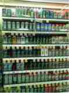
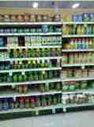

# Project samples

This folder contains visual examples taken from the submitted academic report.

## Shelf/product recognition examples

### Figure 7.1 — report page 31

This report image shows retail shelf products outlined by the recognition system.

### Figure 7.2 — report page 32

A second shelf-recognition output from the Results and Discussions chapter.

## Original repository sample

The original image that was already in the repository is retained at the repository root as [output.png](../../output.png). It is kept there for backward compatibility with existing links. The README links to it alongside the report figures.

## Source and selection notes

- Report: *Advanced Image Recognition for Retail Stock Management* (2024–25).
- Figures 7.1 and 7.2, printed report pages 31 and 32.
- The report's theft-detection examples on page 33 are not included in this public gallery because they show people in CCTV imagery.
- These images are illustrative report outputs, not evidence of independently reproduced model performance.
